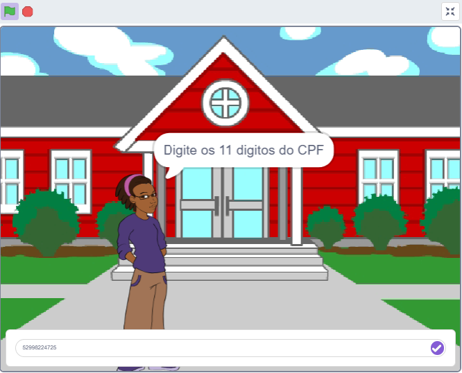
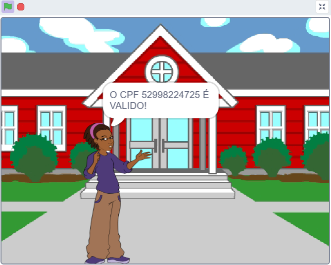

# Validador de CPF

Projeto desenvolvido no **Scratch** com o objetivo de verificar a validade de números de CPF por meio de algoritmos e estruturas de lógica de programação.

## Sobre o projeto

O Validador de CPF é um projeto acadêmico desenvolvido para praticar conceitos de programação, como variáveis, listas, estruturas condicionais, laços de repetição e operações matemáticas.

O sistema recebe um número de CPF e realiza os cálculos necessários para verificar se seus dígitos verificadores correspondem ao resultado esperado.

## Funcionalidades

- Recebimento de um número de CPF.
- Verificação da quantidade de dígitos.
- Cálculo dos dígitos verificadores.
- Identificação de CPFs válidos e inválidos.
- Exibição do resultado da validação.

## Tecnologias utilizadas

- **Scratch:** desenvolvimento da lógica e implementação do projeto.

## Algoritmo utilizado

O projeto utiliza o algoritmo de validação de CPF, que consiste em duas etapas de cálculo dos dígitos verificadores, utilizando operações matemáticas e pesos específicos.

## Demonstração
**Validador de CPF**

  
  
  

**CPF válido**

  
  
  

**CPF inválido**

  
  
  

`Os CPF's utilizados são fictícios apenas para demonstração`
## Como executar

1. Baixe o arquivo `.sb3` disponível neste repositório.
2. Acesse o [Scratch](https://scratch.mit.edu/).
3. Abra o editor e carregue o arquivo do projeto.
4. Execute o programa e informe um CPF para realizar a validação.

OU ACESSE PELO LINK

5. <a href="https://scratch.mit.edu/projects/1410025787">Verificador de CPF</a>

## Objetivo acadêmico

Este projeto foi desenvolvido como atividade de aprendizagem no curso de Desenvolvimento de Sistemas, com foco no desenvolvimento do raciocínio lógico e na aplicação prática de algoritmos.

---

**Desenvolvido por Stênio Moraes.**
